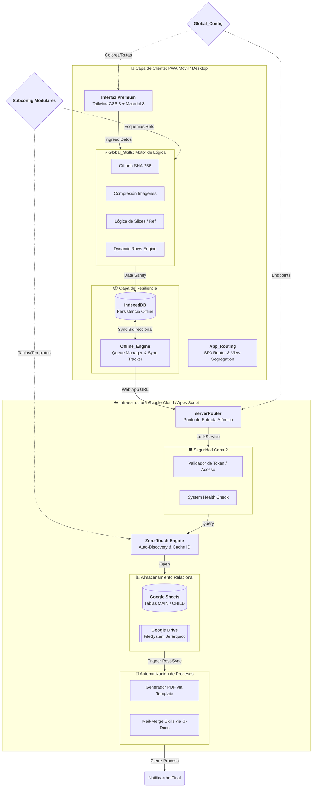

# 🏗️ Esquema de Arquitectura: MOTOR PWA ZERO-TOUCH

Este documento detalla la ingeniería y la interconexión de componentes del sistema en su estado actual.

## 1. Stack Tecnológico
*   **Frontend**: SPA (Single Page Application) basada en **HTML5 / Tailwind CSS 3**.
*   **Backend**: Motor monolítico en **Google Apps Script (V8 Engine)**.
*   **Base de Datos**: Relacional distribuida en **Google Sheets** (pestañas MAIN/CHILD).
*   **Almacenamiento**: Jerárquico en **Google Drive** (Motor de autodescubrimiento).
*   **Resiliencia**: Persistencia local vía **IndexedDB** para operaciones 100% Offline.

## 2. Flujo de Datos (Arquitectura de Sincronización)
1.  **Captura**: El usuario ingresa datos en el móvil. Los archivos se comprimen en el cliente (Skill A).
2.  **Encolado**: Los datos se guardan en el `Offline_Engine` (IndexedDB) con estatus "Pendiente".
3.  **Transmisión**: Al detectar internet, se envía un `Batch` (lote) JSON al `serverRouter` en `Code.gs`.
4.  **Procesamiento Atómico**:
    *   El servidor valida la sesión y el token (SHA-256).
    *   Autodescubre la infraestructura en Drive (Zero-Touch).
    *   Inyecta filas en `MAIN` y `CHILD` simultáneamente.
    *   Dispara la **Skill 10** (Mail-Merge) si existe una plantilla vinculada.

## 3. Seguridad y Privacidad
*   **Cifrado**: Contraseñas protegidas mediante **SHA-256** antes de salir del dispositivo.
*   **Aislamiento**: Cada módulo reside en su propia carpeta de Drive con permisos granulares.
*   **Validación**: Control de estatus "Cesado" que bloquea el ruteo de cualquier acción si el usuario es dado de baja.

## 4. Mapa Maestro de Infraestructura y Flujo de Datos

---
**Versión de Documentación: 1.2.0**
