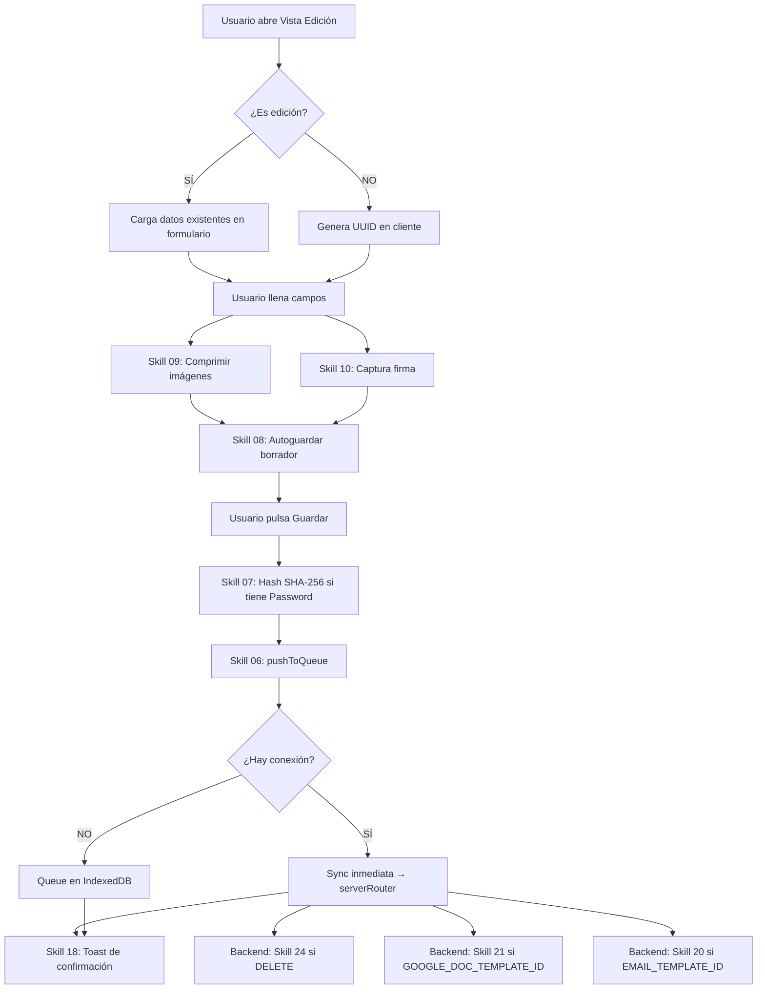

# SKALL.MD — Catálogo Maestro de Skills para PWA Zero-Touch (Google Apps Script)

> Documento de referencia reutilizable para construir aplicaciones empresariales PWA sobre Google Apps Script + Sheets + Drive.
> Cada Skill define su propósito, cuándo aplicarla, la firma técnica y las reglas de implementación.

---

## ÍNDICE

| # | Skill | Categoría | Criticidad |
|---|-------|-----------|------------|
| 01 | [Arquitectura Zero-Touch Backend](#01-arquitectura-zero-touch-backend) | Backend | OBLIGATORIA |
| 02 | [Esquema Subconfig (ADN del Módulo)](#02-esquema-subconfig-adn-del-módulo) | Configuración | OBLIGATORIA |
| 03 | [Vista Resumen / DataGrid Interactivo](#03-vista-resumen--datagrid-interactivo) | Frontend | OBLIGATORIA |
| 04 | [Vista Detalle Premium](#04-vista-detalle-premium) | Frontend | OBLIGATORIA |
| 05 | [Vista Edición / Alta Inteligente](#05-vista-edición--alta-inteligente) | Frontend | OBLIGATORIA |
| 06 | [Motor Offline (IndexedDB + Queue)](#06-motor-offline-indexeddb--queue) | Resiliencia | OBLIGATORIA |
| 07 | [Seguridad y Gestión de Sesión](#07-seguridad-y-gestión-de-sesión) | Seguridad | OBLIGATORIA |
| 08 | [Autoguardado Interactivo (Draft Safe-State)](#08-autoguardado-interactivo-draft-safe-state) | Resiliencia | ALTA |
| 09 | [Compresión de Imágenes Client-Side](#09-compresión-de-imágenes-client-side) | Rendimiento | ALTA |
| 10 | [Pizarra de Firmas Digitales (Signature Pad)](#10-pizarra-de-firmas-digitales-signature-pad) | UI/UX | ALTA |
| 11 | [Exportador Analítico (.xlsx Nativo)](#11-exportador-analítico-xlsx-nativo) | Datos | ALTA |
| 12 | [Exportador CSV (Filas Visibles)](#12-exportador-csv-filas-visibles) | Datos | MEDIA |
| 13 | [Relacionalidad Dinámica (REF + Cascading)](#13-relacionalidad-dinámica-ref--cascading) | Datos | ALTA |
| 14 | [Motor de Filas Dinámicas (Sub-Tablas)](#14-motor-de-filas-dinámicas-sub-tablas) | UI/UX | ALTA |
| 15 | [Enum con Valor Libre (allowOtherValues)](#15-enum-con-valor-libre-allowothervalues) | UI/UX | MEDIA |
| 16 | [Barra de Búsqueda y Filtros Colapsable](#16-barra-de-búsqueda-y-filtros-colapsable) | UI/UX | OBLIGATORIA |
| 17 | [Ordenamiento de Tablas (Sort Engine)](#17-ordenamiento-de-tablas-sort-engine) | UI/UX | MEDIA |
| 18 | [Sistema de Notificaciones Toast](#18-sistema-de-notificaciones-toast) | UI/UX | ALTA |
| 19 | [Renderizador de Media Drive (Galería Premium)](#19-renderizador-de-media-drive-galería-premium) | UI/UX | ALTA |
| 20 | [Motor Mail-Merge (Google Docs Template)](#20-motor-mail-merge-google-docs-template) | Automatización | MEDIA |
| 21 | [Generador PDF desde Template](#21-generador-pdf-desde-template) | Automatización | MEDIA |
| 22 | [Estándar Cronológico (GMT-5 Perú)](#22-estándar-cronológico-gmt-5-perú) | Trazabilidad | OBLIGATORIA |
| 23 | [Sistema de Caché y OTA Cache Busting](#23-sistema-de-caché-y-ota-cache-busting) | Rendimiento | ALTA |
| 24 | [Motor de Basura G-Trash (Eliminación Real)](#24-motor-de-basura-g-trash-eliminación-real) | Backend | ALTA |
| 25 | [UI Global: Header, Footer, Temas Light/Dark](#25-ui-global-header-footer-temas-lightdark) | UI/UX | OBLIGATORIA |
| 26 | [SPA Router (App_Routing)](#26-spa-router-app_routing) | Arquitectura | OBLIGATORIA |
| 27 | [SuperAdmin Dashboard y Logs](#27-superadmin-dashboard-y-logs) | Admin | ALTA |
| 28 | [Flujograma Preventivo (Mermaid)](#28-flujograma-preventivo-mermaid) | Proceso | OBLIGATORIA |
| 29 | [Build y Deploy (generate_preview + Apps Script)](#29-build-y-deploy-generate_preview--apps-script) | DevOps | OBLIGATORIA |
| 30 | [Sincronización Bidireccional Delta (Silent Fetch)](#30-sincronización-bidireccional-delta-silent-fetch) | Resiliencia | ALTA |

---

## 01 — Arquitectura Zero-Touch Backend

**Propósito:** Un solo archivo `Code.gs` maneja TODO el backend. No se modifica al agregar módulos nuevos: el backend los auto-descubre por nombre de carpeta en Drive.

**Cuándo aplicar:** En cada nuevo proyecto. Es la base de toda la arquitectura.

**Estructura obligatoria en `Code.gs`:**

```javascript
const APP_CONFIG = {
  APP_NAME:    'NOMBRE_APP',
  VERSION:     '1.0.0',
  SHEETS: {
    MODULO_X: '01_ModuloX', // Nombre exacto de la hoja en Sheets
  },
  HEADERS: {
    '01_ModuloX': ['UUID', 'Campo1', 'Campo2', ...] // Orden exacto de columnas
  },
  DRIVE_ROOT_FOLDER_NAME: 'NOMBRE_CARPETA_RAIZ_DRIVE'
};
```

**Reglas irrompibles:**
- `HEADERS` debe reflejar el orden exacto de columnas en Google Sheets.
- El punto de entrada web es siempre `doGet(e)` que sirve `PROD_INDEX.html`.
- El router central `serverRouter(jsonPayload)` despacha todas las acciones del frontend: `READ_DB`, `WRITE_DB`, `DELETE_DB`, `UPDATE_DB`, `VALIDATE_SESSION`, etc.
- **LockService** (10 s) protege contra colisiones en escritura concurrente.
- **CacheService** (6 h) guarda IDs de carpetas Drive para evitar búsquedas repetidas.
- Toda respuesta JSON viaja como `JSON.stringify()` comprimido.
- **Bloqueo por Cesado:** Si el servidor detecta `status === "CESADO"` en el token, retorna `{status: "TERMINATED"}` y no procesa ninguna acción.

---

## 02 — Esquema Subconfig (ADN del Módulo)

**Propósito:** Archivo `subconfig_XX_Nombre.js.html` que define el alma de cada módulo: columnas, tipos de datos, permisos, referencias a Drive y templates.

**Cuándo aplicar:** Antes de escribir cualquier vista. El Subconfig es el contrato que une backend y frontend.

**Estructura base:**

```javascript
var SUBCONFIG_XX_NOMBRE = {

  Config_Modular: {
    NombreInterno:         "XX_Nombre",
    DRIVE_FOLDER_NAME:     "XX_Nombre_DB",       // Carpeta en Drive
    GOOGLE_DOC_TEMPLATE_ID: "",                  // ID Doc para generar PDF
    EMAIL_TEMPLATE_ID:     "",                   // ID Doc para Mail-Merge
    PARENT_TABLE:          "MAIN",               // Hoja principal
    CHILD_TABLE:           "CHILD_Nombre",       // Hoja hija (o "" si no aplica)
    RELATIONAL_KEY:        "UUID",               // Llave de relación padre-hijo
    Relational_Fields:     [],                   // Campos de la tabla hija
    AdminRole:      { canCreate: true,  canRead: true,  canUpdate: true,  canDelete: true  },
    SupervisorRole: { canCreate: false, canRead: true,  canUpdate: false, canDelete: false },
    WorkerRole:     { canCreate: true,  canRead: false, canUpdate: false, canDelete: false }
  },

  Variables: {
    // Obligatorio en todo módulo
    "UUID": { type: "Hidden_UUID", required: true, isFilter: false },

    // Ejemplo de campo de texto con filtro
    "Campo_Texto": {
      type: "Text",
      required: true,
      isFilter: true,
      label: "Etiqueta Visual",
      description: "Descripción opcional para el programador"
    },

    // Enum: lista de valores fijos
    "Campo_Enum": {
      type: "Enum",
      required: true,
      isFilter: true,
      label: "Estado",
      acceptedValues: ["Activo", "Pendiente", "Cerrado"],
      allowOtherValues: false  // true = habilita input libre en el frontend
    },

    // EnumList: selección múltiple
    "Campo_EnumList": {
      type: "EnumList",
      required: false,
      isFilter: false,
      label: "Categorías",
      acceptedValues: ["A", "B", "C"],
      allowOtherValues: true
    },

    // REF: selector dinámico de otro módulo
    "Campo_Ref": {
      type: "REF",
      required: true,
      isFilter: true,
      label: "Operario",
      refModule: "01_Usuarios",
      refLabelColumn: "Nombre_Completo",
      refValueColumn: "DNI",
      slice: { column: "Rol", value: "Trabajador" } // Filtro opcional
    },

    // Image: archivo con tracking de ID y Path
    "Foto": { type: "Image", required: false, isFilter: false, label: "Fotografía" },
    "Foto_ID":   { type: "Hidden", required: false },
    "Foto_Path": { type: "Hidden", required: false },

    // Signature: pizarra táctil
    "Firma": { type: "Signature", required: false, isFilter: false, label: "Firma Digital" },
    "Firma_ID":   { type: "Hidden", required: false },
    "Firma_Path": { type: "Hidden", required: false },

    // Password: se hashea con SHA-256 antes de enviar
    "Password_Hash": { type: "Password", required: true, isFilter: false },

    // Date: usa siempre getPeruTime()
    "Fecha": { type: "Date", required: true, isFilter: true, label: "Fecha del Registro" }
  }
};
```

**Tipos de dato disponibles:**

| Tipo | Render Frontend | Almacenamiento |
|------|----------------|----------------|
| `Text` | `<input type="text">` | String |
| `Number` | `<input type="number">` | Número |
| `Date` | `<input type="date">` | ISO String (GMT-5) |
| `Enum` | `<select>` | String |
| `EnumList` | Multi-checkbox o multi-select | CSV String |
| `REF` | `<select>` dinámico | Valor de `refValueColumn` |
| `Image` | Input file + Canvas compress | Base64 → Drive → URL |
| `Signature` | Canvas táctil | PNG Base64 → Drive |
| `Password` | `<input type="password">` | SHA-256 Hash |
| `Hidden` | No visible | String |
| `Hidden_UUID` | No visible | UUID auto-generado |
| `Textarea` | `<textarea>` | String |
| `Boolean` | Checkbox | "true"/"false" |

**Regla de oro DNI:** Siempre `type: "Text"`, nunca Number. Preserva ceros a la izquierda.

---

## 03 — Vista Resumen / DataGrid Interactivo

**Propósito:** Vista principal de listado de registros, de más reciente a más antiguo, con filtros, selección masiva y exportación.

**Cuándo aplicar:** Todo módulo DEBE tener esta vista.

**Componentes obligatorios:**
1. **Barra búsqueda + filtros colapsable** (Skill 16) en una sola fila.
2. **Tabla con checkboxes** para selección masiva (Bulk Edit / Bulk Delete).
3. **Contador de resultados vivos** (`ui-result-count`).
4. **Botón Exportar .xlsx** que respeta filtros aplicados (Skill 11).
5. **Sort Engine** en cabeceras de columna (Skill 17).
6. **Densidad compacta:** `px-3 py-2` en celdas.
7. Orden: **más reciente primero** (`.reverse()` al recibir datos).

**Acciones por fila:**
- Ver Detalle → navega a Vista Detalle.
- Editar → navega a Vista Edición.
- Eliminar → confirma y llama al backend.

**Regla de columnas:** Nunca mostrar UUID ni campos Hidden/Password en la tabla.

---

## 04 — Vista Detalle Premium

**Propósito:** Vista de solo lectura con renderizado enriquecido: imágenes, firmas, documentos y datos del registro.

**Cuándo aplicar:** Todo módulo DEBE tener esta vista.

**Componentes obligatorios:**
1. **Header con flecha de retroceso** → regresa a Vista Resumen.
2. Renderizado de campos `Image` y `Signature` con la Skill 19 (galería de miniaturas con hover).
3. **Jerarquía de acciones vertical** alineada a la derecha:
   - Botón **Editar** (`h-7`, `text-[9px]`, `whitespace-nowrap`).
   - Botón **Descargar PDF** (si `GOOGLE_DOC_TEMPLATE_ID` está configurado).
4. Si el módulo tiene `CHILD_TABLE`, mostrar la sub-tabla de registros hijos.
5. Renderizado de campos `REF` mostrando la etiqueta (`refLabelColumn`), no el valor crudo.

---

## 05 — Vista Edición / Alta Inteligente

**Propósito:** Formulario de creación y edición de registros que se auto-construye según el Subconfig.

**Cuándo aplicar:** Todo módulo DEBE tener esta vista.

**Reglas de construcción del formulario:**
- **Un solo template de vista** sirve tanto para CREATE como para EDIT (detectar por presencia de UUID en params).
- Cada campo se renderiza según su `type` en el Subconfig.
- Campos `Enum` con `allowOtherValues: true` → activar Skill 15.
- Campos `REF` → llamar a `PWA_SKILLS.loadRelationalOptions()`.
- Campos `Signature` → inicializar `PWA_SKILLS.initSignaturePad()`.
- Campos `Image` → aplicar `PWA_SKILLS.compressImage()` antes de encolar.
- Campos `Password` → aplicar `PWA_SKILLS.hashSHA256()` antes de encolar.
- Campos `Hidden_UUID` → auto-generar con `pseudoGenerateUUID()` si es nuevo registro.
- **Autoguardado:** activar Skill 08 en `oninput`/`onblur` de campos pesados.
- Si `CHILD_TABLE` existe → agregar sección de filas dinámicas (Skill 14).
- Acción **Guardar** → `pushToQueue()` (Skill 06). Nunca llamar directo al servidor.
- Header con flecha de retroceso → regresa a Vista Resumen.

**Campos obligatorios del sistema (auto-gestionados, no editables por usuario):**
- `UUID` (generado en cliente)
- `Fecha_Registro` / timestamps (usando Skill 22)
- `_ID` y `_Path` de imágenes (gestionados por el motor de archivos)

---

## 06 — Motor Offline (IndexedDB + Queue)

**Propósito:** Persistencia local de transacciones pendientes. Si falla la conexión, los datos sobreviven indefinidamente hasta sincronizarse.

**Cuándo aplicar:** En TODA acción de escritura del frontend, sin excepción.

**API principal:**

```javascript
// Encolar una acción (NUNCA llamar directo al servidor para escrituras)
await pushToQueue("XX_Modulo", "INSERT", { campo1: valor1, ... }, childDataArray);
await pushToQueue("XX_Modulo", "UPDATE", { UUID: "...", campo1: nuevoValor });
await pushToQueue("XX_Modulo", "DELETE", { UUID: "..." });

// Sincronizar cola pendiente
await syncQueue(); // Se auto-dispara al detectar conexión

// Verificar estado de cola
const pending = await getPendingCount();
```

**Reglas:**
- `UUID` se asigna en el dispositivo cliente ANTES de encolar, no en el servidor.
- El estado del icono de sincronización en el Header refleja el estado de la cola (Skill 25).
- Tras logout por `CESADO`: la cola **hiberna** pero no se vacía. Solo se purga al volver a `Activo`.
- El servidor procesa la cola en **batches** para evitar el timeout de 6 min de Apps Script.

**Estructura de un item en cola:**

```javascript
{
  localQueueId: (autoIncrement),
  moduleName:   "XX_Modulo",
  action:       "INSERT" | "UPDATE" | "DELETE",
  payload:      { UUID: "...", ...campos },
  childData:    [...] | null,
  timestamp:    "ISO-String-GMT-5",
  status:       "Pending" | "Synced" | "Error",
  retries:      0
}
```

---

## 07 — Seguridad y Gestión de Sesión

**Propósito:** Autenticación hash SHA-256, token en LocalStorage, auto-logout por cese y control de roles.

**Cuándo aplicar:** En el módulo de Login y en toda validación de backend.

**Flujo de autenticación:**

```
1. Usuario ingresa DNI + Password
2. Frontend: hash = await PWA_SKILLS.hashSHA256(password)
3. Frontend: google.script.run → serverRouter({action: "VALIDATE_SESSION", DNI, hash})
4. Backend: busca DNI en hoja Usuarios, compara hash, verifica Status ≠ "CESADO"
5. Backend: retorna { status:"OK", token, nombre, rol, status }
6. Frontend: AppState.updateSession(userData) → guarda en LocalStorage
```

**Variables de sesión en LocalStorage:**
- `pwa_user_dni`, `pwa_user_nombre`, `pwa_user_rol`, `pwa_user_token`, `pwa_user_status`

**Mecanismo Anti-Cese:**
- Cada respuesta del servidor incluye el `status` actualizado del usuario.
- Si `status === "CESADO"` → `AppState.clearSession()` (limpia LS y recarga).
- La cola offline queda hibernada con los datos intactos.

**Control de Roles en Frontend:**
- Los botones de acción se muestran/ocultan según `AppState.User.Rol` vs `Config_Modular.XxxRole`.
- El menú principal solo muestra módulos donde el rol tiene al menos `canRead: true`.

**Control de Roles en Backend:**
- El servidor valida el token y el rol antes de ejecutar cualquier acción destructiva.

---

## 08 — Autoguardado Interactivo (Draft Safe-State)

**Propósito:** Guardar borradores del formulario en LocalStorage ante crashes, batería muerta o pérdida de señal.

**Cuándo aplicar:** En formularios de edición/alta con más de 5 campos o con adjuntos.

**Implementación:**

```javascript
// En el <input> o <textarea> del formulario:
oninput="PWA_SKILLS.saveDraft('id-del-form', 'NombreModulo')"

// Al cargar la vista de edición:
PWA_SKILLS.loadDraft('id-del-form', 'NombreModulo');

// Al enviar el formulario correctamente, limpiar el borrador:
localStorage.removeItem('draft_NombreModulo');
```

**Regla:** Los borradores de imágenes/firmas (Base64 pesado) no se guardan en draft para no saturar LocalStorage. Solo campos de texto.

---

## 09 — Compresión de Imágenes Client-Side

**Propósito:** Reducir el peso de imágenes capturadas antes de encolarlas, sin pérdida perceptible de detalle.

**Cuándo aplicar:** En todo campo de tipo `Image` antes de llamar a `pushToQueue`.

**Implementación:**

```javascript
const inputFile = document.getElementById('campo-foto');
inputFile.addEventListener('change', async (e) => {
  const file = e.target.files[0];
  if (!file) return;

  // Calidad: 'Bajo' (0.5x / 0.4bit), 'Medio' (0.7x / 0.7bit), 'Alto' (0.9x / 0.9bit)
  const calidad = AppState.Settings.CalidadCompresion || 'Medio';
  const dataUrl = await PWA_SKILLS.compressImage(file, calidad);

  // dataUrl es el Base64 listo para encolar
  window._fotoComprimida = dataUrl;
});
```

**Configuración global:** `AppState.Settings.CalidadCompresion` controla la calidad por defecto para toda la app.

---

## 10 — Pizarra de Firmas Digitales (Signature Pad)

**Propósito:** Canvas táctil y de mouse para captura de firma biométrica, exportada como PNG Base64.

**Cuándo aplicar:** En campos de tipo `Signature` en la Vista Edición.

**HTML mínimo requerido:**

```html
<div class="border rounded-xl overflow-hidden bg-white" style="touch-action:none;">
  <canvas id="canvas-firma" class="w-full" style="height:160px;"></canvas>
</div>
<div class="flex gap-2 mt-2">
  <button type="button" onclick="PWA_SKILLS.clearSignature('canvas-firma')">Limpiar</button>
</div>
```

**Inicialización:**

```javascript
// Al renderizar la vista de edición:
PWA_SKILLS.initSignaturePad('canvas-firma');

// Al guardar, extraer la firma como Base64:
const canvas = document.getElementById('canvas-firma');
const firmaBase64 = canvas.toDataURL('image/png');
// Incluir firmaBase64 en el payload de pushToQueue
```

**Regla:** Siempre llamar `initSignaturePad` DESPUÉS de que el canvas esté visible en el DOM.

---

## 11 — Exportador Analítico (.xlsx Nativo)

**Propósito:** Descargar la data visible en tabla como archivo .xlsx real (no CSV renombrado), usando la librería SheetJS.

**Cuándo aplicar:** Botón "Exportar" en toda Vista Resumen.

**Dependencia:** `<script src="https://cdnjs.cloudflare.com/ajax/libs/xlsx/0.18.5/xlsx.full.min.js"></script>` en el Index.

**Implementación estándar:**

```javascript
// Exportar desde la tabla visible (respeta filtros)
PWA_SKILLS.exportFilteredToExcel(); // Usa AppState.activeModule para nombrar el archivo

// Exportar desde un array JSON específico
PWA_SKILLS.exportToExcel(arrayDeDatos, "NombreArchivo");
```

**Comportamiento:**
- Omite columnas de acciones (`acciones`, `gestión`, `ver`).
- Solo exporta filas visibles (no las ocultas por filtros).
- Nombre del archivo: `NombreModulo_YYYYMMDD.xlsx`.

---

## 12 — Exportador CSV (Filas Visibles)

**Propósito:** Alternativa ligera al .xlsx para reportes rápidos, respetando filtros activos.

**Cuándo aplicar:** Botón secundario de exportación, o cuando no esté disponible SheetJS.

**Implementación:**

```javascript
PWA_SKILLS.exportVisibleToCSV('nombre-slug-modulo');
// El archivo descargado incluye BOM UTF-8 para compatibilidad con Excel en español.
```

---

## 13 — Relacionalidad Dinámica (REF + Cascading)

**Propósito:** Selectores que cargan opciones desde otro módulo en tiempo real, con soporte de filtrado condicional (slice).

**Cuándo aplicar:** En campos de tipo `REF` en la Vista Edición, y en Dropdowns Dependientes.

**Implementación:**

```javascript
// Carga básica de un REF
await PWA_SKILLS.loadRelationalOptions(
  'select-operario',          // ID del <select>
  '01_Usuarios',              // Módulo de origen
  'Nombre_Completo',          // Columna a mostrar
  'DNI',                      // Columna a guardar como valor
  null                        // Sin filtro slice
);

// Con slice (solo mostrar Trabajadores, no Admins)
await PWA_SKILLS.loadRelationalOptions(
  'select-operario',
  '01_Usuarios',
  'Nombre_Completo',
  'DNI',
  { column: 'Rol', value: 'Trabajador' }
);
```

**Cascading (Dropdowns Dependientes):**

```javascript
// Primer select dispara la carga del segundo:
document.getElementById('select-area').addEventListener('change', async (e) => {
  await PWA_SKILLS.loadRelationalOptions(
    'select-equipo',
    '05_Equipos',
    'Nombre_Equipo',
    'UUID',
    { column: 'Area', value: e.target.value } // El valor del primer select filtra el segundo
  );
});
```

**Caché:** Los datos de referencia se cachean en LocalStorage con clave `refdata_XX_Modulo` para evitar llamadas repetidas al servidor.

---

## 14 — Motor de Filas Dinámicas (Sub-Tablas)

**Propósito:** Formulario con filas repetibles para registrar múltiples ítems dentro de un mismo registro (tabla hija).

**Cuándo aplicar:** Cuando el módulo tiene `CHILD_TABLE` definido en el Subconfig.

**HTML contenedor:**

```html
<div id="dynamic-rows-container"></div>
<button type="button" onclick="PWA_SKILLS.addDynamicRow('dynamic-rows-container', SUBCONFIG_XX.Config_Modular.Relational_Fields)">
  + Agregar ítem
</button>
```

**Definición de campos en Subconfig:**

```javascript
Relational_Fields: [
  { name: "Descripcion",  label: "Descripción",  type: "text",   colSpan: "md:col-span-5" },
  { name: "Cantidad",     label: "Cantidad",      type: "number", colSpan: "md:col-span-2" },
  { name: "Unidad",       label: "Unidad",        type: "text",   colSpan: "md:col-span-2" },
  { name: "Observacion",  label: "Observación",   type: "text",   colSpan: "md:col-span-2" }
]
```

**Extracción al guardar:**

```javascript
const filas = [];
document.querySelectorAll('#dynamic-rows-container > div').forEach(row => {
  const obj = {};
  row.querySelectorAll('input, select').forEach(inp => { obj[inp.name] = inp.value; });
  if (Object.values(obj).some(v => v)) filas.push(obj); // Solo filas con al menos un valor
});
// 'filas' va como childDataArray en pushToQueue
```

---

## 15 — Enum con Valor Libre (allowOtherValues)

**Propósito:** Select que, al elegir "Otro", habilita un input libre para ingresar un valor no listado.

**Cuándo aplicar:** En campos `Enum` o `EnumList` con `allowOtherValues: true` en el Subconfig.

**HTML requerido:**

```html
<select id="select-categoria">
  <option value="">Seleccione...</option>
  <option value="Opción A">Opción A</option>
  <option value="Opción B">Opción B</option>
  <option value="__OTHER__">Otro (especificar)...</option>
</select>
<input type="text" id="input-categoria-otro" placeholder="Especifique..." style="display:none;">
```

**Inicialización y lectura:**

```javascript
PWA_SKILLS.initEnumWithOther('select-categoria', 'input-categoria-otro');

// Al guardar:
const valorFinal = PWA_SKILLS.getEnumValue('select-categoria', 'input-categoria-otro');
```

---

## 16 — Barra de Búsqueda y Filtros Colapsable

**Propósito:** Control unificado de búsqueda global y filtros dinámicos en una sola fila. El panel de filtros se expande/colapsa.

**Cuándo aplicar:** En toda Vista Resumen, como primer elemento del contenido.

**Implementación:**

```javascript
// 1. Renderizar la barra
PWA_SKILLS.renderSearchBar('contenedor-barra', 'Buscar registros...');

// 2. Inyectar filtros dinámicos desde el Subconfig
PWA_SKILLS.renderDynamicFilters('XX_NOMBRE'); // Usa variables con isFilter: true

// 3. Los filtros se aplican automáticamente al pulsar "Aplicar" o al escribir en la búsqueda
// También se pueden aplicar manualmente:
PWA_SKILLS.applyFilters();

// 4. Limpiar todos los filtros:
PWA_SKILLS.clearFilters();
```

**Regla:** Los filtros se generan dinámicamente leyendo `isFilter: true` del Subconfig. Nunca hardcodear filtros en el HTML del módulo.

---

## 17 — Ordenamiento de Tablas (Sort Engine)

**Propósito:** Ordenamiento cliente-side por columna (asc/desc/ninguno) en la Vista Resumen.

**Cuándo aplicar:** En toda tabla de Vista Resumen tras renderizar los datos.

**Implementación:**

```javascript
// Llamar DESPUÉS de poblar la tabla con datos:
PWA_SKILLS.initSortableTable('id-del-tbody');

// Para excluir una columna del sort (ej: columna de acciones):
// Agregar al <th> el atributo: data-nosort
```

**Comportamiento:** Click en cabecera → asc → desc → original. Icono visual en la columna activa.

---

## 18 — Sistema de Notificaciones Toast

**Propósito:** Notificaciones no intrusivas tipo snackbar/toast para feedback al usuario.

**Cuándo aplicar:** Tras guardar, sincronizar, exportar, eliminar, o ante cualquier error.

**Contenedor requerido en el Index:**

```html
<div id="toast-container" style="position:fixed;bottom:80px;right:16px;z-index:9999;display:flex;flex-direction:column;gap:8px;pointer-events:none;"></div>
```

**API:**

```javascript
PWA_SKILLS.toast('Registro guardado correctamente.', 'success');  // Verde
PWA_SKILLS.toast('No hay conexión a internet.', 'warning');        // Amarillo
PWA_SKILLS.toast('Error al sincronizar.', 'error');                // Rojo
PWA_SKILLS.toast('Sincronizando datos...', 'info', 2000);          // Azul, 2 s
// 4° parámetro: duración en ms (default: 3200)
```

---

## 19 — Renderizador de Media Drive (Galería Premium)

**Propósito:** Mostrar imágenes y firmas almacenadas en Drive dentro de la Vista Detalle, con grid responsivo y zoom.

**Cuándo aplicar:** En la Vista Detalle, para todos los campos `Image` y `Signature`.

**Implementación:**

```javascript
// En la Vista Detalle, tras cargar el registro:
PWA_SKILLS.renderDriveMedia(registro['Foto_Path'], 'Foto', 'contenedor-foto');
PWA_SKILLS.renderDriveMedia(registro['Firma_Path'], 'Firma', 'contenedor-firma');

// El contenedor HTML:
// <div id="contenedor-foto"></div>
```

**Comportamiento:** Si el valor es vacío muestra un placeholder. Si hay múltiples URLs (separadas por coma), las organiza en grid. Efecto hover con zoom y etiqueta "Ver en Grande".

**Seguridad:** Solo permite URLs con protocolo `https://`, `http://` o `data:image/`. Bloquea cualquier otra fuente.

---

## 20 — Motor Mail-Merge (Google Docs Template)

**Propósito:** Envío automático de correos profesionales tras sincronización, usando una plantilla de Google Docs.

**Cuándo aplicar:** Cuando el Subconfig define `EMAIL_TEMPLATE_ID` con un ID válido.

**Configuración del template en Google Docs:**
- Variables: `<<[NOMBRE_CAMPO]>>` — se reemplazan con los valores del registro.
- Variable especial `<<[TABLA_HIJA]>>` — se reemplaza con los ítems del CHILD_TABLE.
- Variable `<<[UUID]>>` — número de ticket único.

**Flujo (automático en el backend tras `WRITE_DB` exitoso):**
1. Backend lee `EMAIL_TEMPLATE_ID` del módulo.
2. Crea copia temporal del Doc en Drive.
3. Reemplaza todas las variables `<<[...]>>` con los valores del registro.
4. Extrae el HTML del Doc y lo envía con `MailApp.sendEmail()`.
5. Elimina la copia temporal.

**Regla:** El correo se envía al valor del campo configurado como destinatario (usualmente `Email` o `Inspector_Email`). El campo debe existir en el registro.

---

## 21 — Generador PDF desde Template

**Propósito:** Generar un PDF del registro usando un template de Google Docs, guardarlo en Drive y guardar la URL en el registro.

**Cuándo aplicar:** Cuando el Subconfig define `GOOGLE_DOC_TEMPLATE_ID` con un ID válido.

**Flujo (automático en backend tras `WRITE_DB` exitoso):**
1. Backend lee `GOOGLE_DOC_TEMPLATE_ID`.
2. Crea copia del Doc en la carpeta `Files/AÑO/MES/DNI/` del módulo.
3. Reemplaza variables `<<[...]>>` con valores del registro.
4. Convierte el Doc a PDF y guarda en Drive.
5. Registra la URL pública del PDF en la columna `PDF_URL` del registro en Sheets.

**Estructura de carpetas en Drive:**
```
MOTOR_PWA_DATA/
  XX_Modulo_DB/
    Files/
      2026/
        06/
          12345678/         ← DNI del usuario
            UUID_reporte.pdf
```

---

## 22 — Estándar Cronológico (GMT-5 Perú)

**Propósito:** Toda fecha y timestamp generado (cliente o servidor) normalizado a UTC-5, sin importar el huso del dispositivo.

**Cuándo aplicar:** En CUALQUIER campo de fecha/hora, en cliente y en servidor.

**Frontend:**

```javascript
// Obtener fecha/hora actual en GMT-5
const timestampCompleto = PWA_SKILLS.getPeruTime(true);  // "2026-06-08T15:30:00.000Z"
const soloFecha        = PWA_SKILLS.getPeruTime(false); // "2026-06-08"

// Para filtros de rango de fechas, siempre comparar contra getPeruTime()
```

**Backend (Code.gs):**

```javascript
function getPeruTimestamp() {
  const now = new Date();
  const peruOffset = -5 * 60; // minutos
  const utc = now.getTime() + (now.getTimezoneOffset() * 60000);
  return new Date(utc + peruOffset * 60000).toISOString();
}
```

**Regla absoluta:** Nunca usar `new Date()` directamente para almacenar fechas. Siempre pasar por el normalizador GMT-5.

---

## 23 — Sistema de Caché y OTA Cache Busting

**Propósito:** Evitar que los usuarios trabajen con versiones obsoletas del frontend tras un deploy.

**Cuándo aplicar:** En cada deploy de nueva versión.

**Mecanismo:**
1. Al cargar la app, el frontend pide al servidor la `VERSION` actual.
2. Compara con la versión almacenada en LocalStorage.
3. Si difieren → `window.location.reload(true)` para forzar recarga limpia.
4. Actualiza la versión en LocalStorage.

**Implementación en frontend:**

```javascript
// En la inicialización de la app:
google.script.run.withSuccessHandler(res => {
  const serverVersion = JSON.parse(res).VERSION;
  const localVersion = localStorage.getItem('pwa_version');
  if (localVersion && localVersion !== serverVersion) {
    localStorage.setItem('pwa_version', serverVersion);
    window.location.reload(true);
  } else {
    localStorage.setItem('pwa_version', serverVersion);
  }
}).serverRouter(JSON.stringify({ action: 'GET_VERSION' }));
```

**Backend:**

```javascript
case 'GET_VERSION':
  return JSON.stringify({ VERSION: APP_CONFIG.VERSION });
```

---

## 24 — Motor de Basura G-Trash (Eliminación Real)

**Propósito:** Eliminación real de filas en Sheets (sin dejar filas vacías) y de adjuntos en Drive.

**Cuándo aplicar:** En toda acción DELETE del módulo.

**Backend:**

```javascript
// Eliminar fila (siempre usar deleteRow, nunca clearRow)
sheet.deleteRow(rowIndex); // Sin registros blancos

// Eliminar archivos de Drive (papelera)
// El frontend confirma primero con el usuario:
// "¿Confirmas vaciar permanente los adjuntos también de la papelera?"
DriveApp.getFileById(fileId).setTrashed(true);
```

**Frontend:**

```javascript
async function eliminarRegistro(uuid) {
  const confirmar = confirm('¿Eliminar este registro? Esta acción no se puede deshacer.');
  if (!confirmar) return;

  const conAdjuntos = confirm('¿Eliminar también los archivos adjuntos de Drive?');

  await pushToQueue('XX_Modulo', 'DELETE', { UUID: uuid, deleteFiles: conAdjuntos });
  PWA_SKILLS.toast('Registro enviado a eliminación.', 'success');
}
```

---

## 25 — UI Global: Header, Footer, Temas Light/Dark

**Propósito:** Interfaz consistente en todos los módulos: navegación persistente, toggle de tema y estado de sincronización.

**Cuándo aplicar:** Es la carcasa de toda la app. Se define una sola vez en el Index.

**Componentes del Header (izquierda → derecha):**
1. Flecha de retroceso (contextual: aparece en vistas que no sean el Menú Principal).
2. Logo / Nombre de la app.
3. **Botón Sincronización Global** (`id="ui-global-sync-btn"`) — icono `sync`, anima al pulsar.
4. **Indicador de Estado Offline** — rojo parpadeante si hay cola pendiente, verde fijo si sincronizado.
5. **Toggle Tema** Light/Dark — cambia `AppState.Settings.Theme` y rempapea variables CSS.
6. Avatar/Nombre del usuario — al pulsar, muestra menú de perfil y botón "Cerrar Sesión".

**Toggle de Tema:**

```javascript
function toggleTheme() {
  const current = AppState.Settings.Theme;
  const next = current === 'light' ? 'dark' : 'light';
  AppState.Settings.Theme = next;
  localStorage.setItem('pwa_theme', next);
  document.documentElement.setAttribute('data-theme', next);
}
```

**Footer:** Copyright + versión. Siempre visible.

**FAB (Botón flotante radial):** Exclusivo del módulo SuperAdmin para System Health. No usar en módulos regulares.

---

## 26 — SPA Router (App_Routing)

**Propósito:** Navegación de vista única (Single Page Application) sin recargas de página, manejando la URL y el historial del navegador.

**Cuándo aplicar:** Es la columna vertebral del frontend. Se define una vez en `App_Routing.js.html`.

**API de navegación:**

```javascript
// Navegar a una vista
AppRouter.navigate('resumen', { modulo: 'XX_Nombre' });
AppRouter.navigate('detalle', { modulo: 'XX_Nombre', uuid: '123e456...' });
AppRouter.navigate('edicion', { modulo: 'XX_Nombre', uuid: '123e456...' }); // uuid = null → CREATE
AppRouter.navigate('menu');

// Retroceder
AppRouter.back();
```

**Responsabilidades del Router:**
1. Cargar el HTML de la vista en `#main-container`.
2. Ejecutar el script de inicialización de la vista recién cargada.
3. Actualizar `AppState.activeModule`.
4. Manejar el botón físico "Atrás" del navegador/dispositivo.

---

## 27 — SuperAdmin Dashboard y Logs

**Propósito:** Panel de control exclusivo para rol Admin con visibilidad de logs de sincronización y herramienta de validación de esquemas.

**Cuándo aplicar:** En toda app con más de 2 módulos y acceso multi-usuario.

**Funcionalidades obligatorias:**
1. **Log de Sincronización:** Tabla de la hoja `_SYNC_LOG` (Timestamp, Módulo, Acción, UUID, Usuario, Resultado).
2. **System Health FAB:** Botón flotante radial que al pulsar compara las columnas de cada hoja de Sheets contra el `HEADERS` del `APP_CONFIG`. Alerta si hay columnas extra, faltantes o mal ordenadas.
3. **Gestión de Usuarios:** Acceso directo al módulo `01_Usuarios`.
4. **Versión del sistema** y estado de cada módulo.

**Backend para Health Check:**

```javascript
case 'SYSTEM_HEALTH':
  // Compara APP_CONFIG.HEADERS vs. la fila 1 de cada hoja
  // Retorna { modulo: 'XX', estado: 'OK' | 'ERROR', diff: [...] }
```

---

## 28 — Flujograma Preventivo (Mermaid)

**Propósito:** Diagramar el flujo Frontend-Backend ANTES de escribir código para validar la lógica con el equipo.

**Cuándo aplicar:** Obligatorio antes de desarrollar cualquier módulo nuevo o flujo complejo.

**Template de flujograma para un módulo estándar:**



---

## 29 — Build y Deploy (generate_preview + Apps Script)

**Propósito:** Proceso para compilar el frontend distribuido en múltiples archivos `.html` en un único `PROD_INDEX.html` listo para Apps Script.

**Cuándo aplicar:** Ante cualquier cambio en archivos de `00_Config/` o adición de módulo.

**Comandos:**

```bash
# Regenerar los archivos de vista previa y producción
node generate_preview.js
# Genera: LOCAL_PREVIEW.html (prueba local) y PROD_INDEX.html (para Apps Script)
```

**Regla Skill 14 del código:** Cualquier cambio en `Global_Config`, `Global_Skills`, `App_Routing`, u `Offline_Engine` EXIGE ejecutar `generate_preview.js` antes de cualquier prueba.

**Flujo de deploy a producción:**
1. `node generate_preview.js`
2. Abrir Google Apps Script del proyecto.
3. Pegar el contenido de `PROD_INDEX.html` en el archivo `PROD_INDEX.html` de Apps Script.
4. Pegar el contenido de `Code.gs` en el archivo `Code.gs` de Apps Script.
5. Deploy → Gestionar implementaciones → Nueva implementación.
6. Copiar la URL del Web App y actualizar `AppState.WEB_APP_URL` en `Global_Config.js.html`.
7. Incrementar `AppState.VERSION` para activar OTA Cache Busting (Skill 23).

---

## 30 — Sincronización Bidireccional Delta (Silent Fetch)

**Propósito:** Actualización periódica silenciosa de datos en background, detectando registros nuevos o modificados por otros usuarios.

**Cuándo aplicar:** En módulos donde múltiples usuarios pueden modificar datos simultáneamente.

**Implementación:**

```javascript
let _lastSyncTime = PWA_SKILLS.getPeruTime(true);

// Polling silencioso cada N milisegundos (configurable en AppState.Settings.OfflineSyncInterval)
setInterval(async () => {
  if (!AppState.User.Token) return; // No sincronizar si no hay sesión

  google.script.run
    .withSuccessHandler(res => {
      const data = JSON.parse(res);
      if (data.status === 'OK' && data.payload.length > 0) {
        // Mergear nuevos registros en la vista actual sin recargar
        mergeNewRecords(data.payload);
        _lastSyncTime = PWA_SKILLS.getPeruTime(true);
      }
    })
    .serverRouter(JSON.stringify({
      action: 'DELTA_SYNC',
      moduleName: AppState.activeModule,
      lastSync: _lastSyncTime
    }));
}, AppState.Settings.OfflineSyncInterval); // Default: 120000 ms (2 min)
```

**Backend:**

```javascript
case 'DELTA_SYNC':
  // Retorna solo filas donde Fecha_Registro > payload.lastSync
  // Compara en el mismo huso horario (GMT-5)
```

---

## REGLAS TRANSVERSALES (aplican a todas las Skills)

1. **Sin frameworks externos de bloqueo:** Cero React, Angular, Vue, Bootstrap o jQuery. Solo Vanilla JS moderno, Tailwind CSS 3 y librería puntual (SheetJS para XLSX).
2. **DNI siempre como String:** Nunca `type: "Number"` para DNI. Se pierden los ceros iniciales.
3. **UUID en el cliente:** Se genera en el dispositivo antes de `pushToQueue`, nunca en el servidor.
4. **Toda escritura pasa por la Queue:** Sin excepciones. Nunca llamar directamente al servidor para INSERT/UPDATE/DELETE.
5. **Tailwind con tema customizado:** Los colores vienen de `AppState.UI_Styles.Tailwind_Theme`, no de las clases estándar de Tailwind. Usar variables CSS custom (ej: `bg-primary`, `text-on-surface`).
6. **Material Symbols Outlined:** Librería de iconos oficial. Siempre `<span class="material-symbols-outlined">nombre_icono</span>`.
7. **Sin comentarios de estado en el código:** Los comentarios documentan el PORQUÉ (invariantes, restricciones ocultas). No el QUÉ.
8. **Trazabilidad de archivos en Drive:** Todo campo `Image`/`Signature` cargado a Drive DEBE registrar automáticamente las columnas `_ID` y `_Path` en el Sheets.
9. **Timestamps siempre en GMT-5:** Sin excepción en cliente ni servidor (Skill 22).
10. **Flujograma antes de código:** En módulos nuevos, siempre Skill 28 primero, código después.

---

*Versión: 1.0.0 — Generado para MOTOR PWA Zero-Touch | 2026-06-08*
